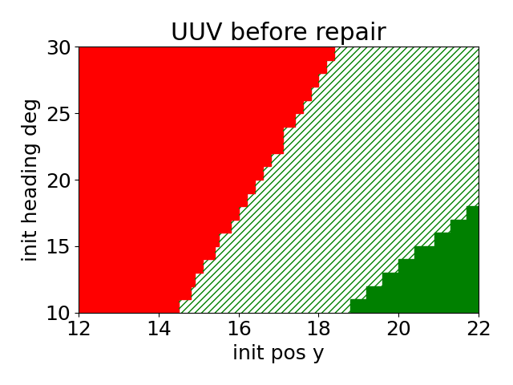

# Repeatability Package of Incremental Simulated Annealing Repair

### Step 0: Prepare required packages

This is the repeatability package for ICCPS 2024 Submission "Repairing Learning-Enabled Controllers While Preserving What Works".
To run our code, `Python >= 3.7.0` needs to be installed, and then the required packages shall be installed by
```
pip install -r requirements.txt
```

With recent package versions, the code fails: it uses `DataFrame.append`, which was removed in pandas 2.0, and loads whole PyTorch models with `torch.load`, which loads weights only by default since PyTorch 2.6.
Use a dedicated environment with older versions instead. The following environment was tested on macOS (Apple Silicon):

```
conda create -n isar python=3.10 -y
conda activate isar
pip install "numpy<2" "pandas<2" "torch<2.6" "scipy==1.13.1" pyyaml matplotlib
```

- `numpy<2` is required by pandas 1.5.
- `scipy==1.13.1`, since newer scipy wheels failed to load on recent macOS.
- `gym`, `stable_baselines3` and `casadi` in `requirements.txt` are only needed for the baselines in `mc_baselines/` and `uuv_baselines/`.

To check the environment, the following should print `1.5.3 2.5.1 True`:

```
python -c "import pandas as pd, torch; print(pd.__version__, torch.__version__, hasattr(pd.DataFrame, 'append'))"
```

The Simulink benchmarks in `benchmark/` are simulated in MATLAB through the MATLAB Engine for Python. Install it into the same environment from the local MATLAB installation (MATLAB R2026a on macOS here):

```
pip install /Applications/MATLAB_R2026a.app/extern/engines/python
```

The following should print the MATLAB version (starting MATLAB may take a while):

```
python -c "import matlab.engine; eng = matlab.engine.start_matlab(); print(eng.version()); eng.quit()"
```

The supported Python versions depend on the MATLAB release: R2026a supports Python 3.9 to 3.13, while R2021a supports only Python 3.7 and 3.8.
For MATLAB R2021a (e.g. on a Linux server), use Python 3.8 instead.
The engine is installed from the MATLAB installation folder, which is two levels above the `matlab` command (e.g. `/data1/deyun/MATLAB/R2021a` for `/data1/deyun/MATLAB/R2021a/bin/matlab`):

```
conda create -n isar python=3.8 -y
conda activate isar
conda env config vars set PYTHONNOUSERSITE=1
conda deactivate && conda activate isar
pip install "numpy<2" "pandas<2" "torch<2.5" scipy pyyaml matplotlib
pip install "setuptools<66"
MATLABROOT=$(dirname $(dirname $(readlink -f $(which matlab))))
cd $MATLABROOT/extern/engines/python
python setup.py build --build-base=$HOME/tmp/matlab_engine_build install
```

- `torch<2.5`, since PyTorch 2.5 dropped Python 3.8.
- `setuptools<66`, since the `setup.py` of R2021a gives its version as `R2021a`, which setuptools 66 and later reject (`InvalidVersion: 'R2021a'`). The deprecation warnings printed during the installation can be ignored.
- `--build-base` builds the engine in a folder of your own, in case the MATLAB installation is not writable.
- The engine is only needed for the Simulink benchmarks; MC and UUV run without MATLAB.
- `PYTHONNOUSERSITE=1` makes the environment ignore packages installed with `pip install --user` (in `~/.local`). Otherwise they take precedence over the versions above and can also break the engine installation (`packaging` from `~/.local` raising `InvalidVersion: 'R2021a'`). `python -c "import numpy, pandas, torch, packaging; print(numpy.__file__, pandas.__file__, torch.__file__, packaging.__file__)"` must show only paths inside the environment.

Check the environment with the same two commands as above. The first one prints other versions here (e.g. `1.5.3 2.4.1 True`), but must end with `True`.

### Step 1: Generate iniitial state space partitions

First, we partition the initial state regions by calling

```
python generate_partition.py --benchmark=<uuv|mc>
```

This will generate a partition of initial state space for UUV or MC. The partition is saved as a csv file, with each rectangular
region's lower bound and higher bound of every dimension.


### Step 2: Verify controller networks on initial state regions

We call Verisig, a sound but incomplete verifier, to verify whether a control policy network can satisfy the given STL task on each partitioned region.
The first step is to install Verisig. A copy of the Verisig source [https://github.com/verisig/verisig] is included in `verisig/`, which is also the default `--verisig_path`.
The following steps are from the Quick Start section of `verisig/UserManual.pdf`, tested by the Verisig authors on Ubuntu 16.04 with Java 1.8:

```
# 1. Install Flow* libraries
apt install libgmp3-dev libmpfr-dev libmpfr-doc libmpfr4 libmpfr4-dbg gsl-bin libgsl0-dev bison flex gnuplot-x11 libglpk-dev

# 2. Compile Flow*
cd verisig/flowstar; make; cd ..

# 3. Compile Verisig
cd verisig-src; ./gradlew installDist; cd ..

# 4. Run the Mountain Car example, which should end with a SAFE result
./verisig --flowstar-cmd=./flowstar/flowstar examples/mountain_car/MC.xml examples/mountain_car/sig16x16.yml
```

Notes:
- `verisig/flowstar/Makefile` also links against `yaml-cpp`, which is not listed in the manual (`apt install libyaml-cpp-dev`).
- The library paths used by `make` are set in `verisig/flowstar/makefile.local` (default `/usr/local/include` and `/usr/local/lib`). Change them if the libraries are installed elsewhere, e.g. `/opt/homebrew/include` and `/opt/homebrew/lib` on Apple Silicon macOS.

After Verisig is installed, please notice that we have prepared a `.cfg` and `.xml` file for both UUV and MC. These files encode the system dynamics.
We also have a `...multi.yml` for both. This file encodes the STL specification.

The initial broken controller networks are in `/controllers`. Verisig requires `.yml` files for neural network controllers.

Two versions of the initial MC controller are included. Both have a 2-16-16-1 architecture with Sigmoid, Sigmoid, and Tanh activations, but different weights and biases:

| Model file | Version |
| --- | --- |
| `controllers/mc_sig_2x16_broken_new.yml` | Updated MC controller from upstream commit `dd60cb1` (2025-07-10). This is the default MC model. |
| `controllers/mc_sig_2x16_broken_old.yml` | Original, lower-performing MC controller from upstream commit `fd67e94` (2024-01-29). |

Select the version explicitly with `--network`. Generate sampling and verification results separately for each model, using distinct output paths; do not reuse one model's results for the other. The UUV controller is unchanged.

With Verisig installed and all files prepared, we call the following code for parallel verification on initial state regions.

```
python verisig_call.py --benchmark=<uuv|mc> --network=<control network yaml file> --verisig_path=<directory where verisig is installed> --verisig_output_path=<directory to write verisig output txt files> --cpu_ratio=<percentage of cpus to be used, between 0 and 1> --initial_state_regions_path=<csv file of partitioned regions from previous step>
```

Warning: Running Verisig parallel verification may take a very long time (please expect more than 12 hours), depending on CPU utilization. Verification log of each initial state region will be recorded in a txt file in the specified output directory. This will take a large storage (please expect over 1GB).

After all regions are verified, we can parse the results by calling
```
python verisig_parse_results.py --benchmark=<uuv|mc> --network=<control network yaml file> --verisig_output_path=<directory of verisig output txt files> --initial_state_regions_csv=<csv file of partitioned regions from previous step>
```
The verification of each region will be run in a subprocess, output to a txt log file.
The verification results of all initial state regions will be parsed from Verisig logs and written to another csv file.
Execution time of verifying each region will be recorded at the end of every txt log file.

### Step 3: Repair controller networks

**Please notice that due to randomness (from random sampling of initial states per region and random perturbation in simulated annealing), the output may not necessarily be the same as in our paper.**

After verification on the broken controller is done, we repair the controller by Incremental Simulated Annealing Repair (ISAR). 
First, we uniformly sample initial states from each region.
```
python sample_states_in_regions.py --benchmark=<uuv|mc> --network=<control network yaml to be repaired> --initial_state_regions_path=<csv file of partitioned regions from previous step> --sampled_result_path=<ampling result csv to be written> --num_samples_per_region=<a positive int, by default 10>
```
This will sample a fixed number of initial states per region and obtain STL robustness of each sampled state. The result will be written in the specified sampled result path as a csv.

Next, with initial states sampled, we run the ISAR algorithm by calling
```
python incremental_repair.py --benchmark=<uuv|mc> --network=<control network yaml to be repaired> --verisig_result_path=<verisig result csv> --sampled_result_path=<sampling result csv> --output_path=<directory to all output files>
```
This is the main repair algorithm. At every iteration, the network will be checkpointed as both yaml and PyTorch files if the selected region is repaired and no good sampled states are broken.
The new STL robustness on all sampled states will also be checkpointed as csv files.
Please expect that this will take a long time, around 1-2 days. Notice that the system dynamics informaion is encoded in `uuv_model_oneHz.mat`.
Since the repaired network and the new STL robustness will be checkpointed after every iteration, we can always early stop and use one of the checkpoints as the output.
Execution time of repairing each region will be displayed in the standard output.


### Step 4: Verify the repaired controller
The repaired network can be verified again using Verisig. It is the same operation as step 2, except that the input network yaml file into `verisig_call.py` is replaced by the repaired file.
Notice that we don't necessarily need to use the very last repaired network - any checkpointed network during the repair procedure can also be verified again and see the outcome.


### Step 5: Visualize results
Once we have a verification result and a sampled result (both as csv files) for a controller network, we can visualize the outcome as in our paper.
By calling
```
python visualization.py --benchmark=<uuv|mc> --verisig_result_path=<verisig result csv> --sampled_result_path=<sampling result csv> 
```
It will end up with a plot like the follows.



Configurations of this plot, such as title, ticks and size can be modified in `visualization.py`.
This code will also output the number of the three types of regions,
and the mean and std of min STL robustness in red, non-red and overall regions (as in our Table 1 and 3).

### Note on the MC dynamics

The MC simulator used for sampling and repair (`mc_simulate` in `incremental_repair_utils.py`) updates the position with the velocity of the previous step (explicit Euler; clipping of position and velocity omitted below):

```
pos[t+1] = pos[t] + vel[t]
vel[t+1] = vel[t] + 0.0015 * u[t] - 0.0025 * cos(3 * pos[t])
```

This differs slightly from the standard Mountain Car (Sutton & Barto, OpenAI Gym), which updates the position with the new velocity, `pos[t+1] = pos[t] + vel[t+1]`.
The Verisig model `mc.xml` and the gym environment `mc_baselines/mc_gym.py` follow the standard form.
We keep the ISAR implementation unchanged, so that results remain comparable with the original ISAR implementation. When comparing other methods on MC, use the same dynamics as `mc_simulate`.

### Example: the full pipeline on UUV

The commands below run Steps 1-5 on the UUV benchmark with concrete file names, so they can be copied as is.
Run them from the repository root, after installing the packages (Step 0) and Verisig into `verisig/` (Step 2).

All generated files are kept in `results/uuv/`. Some scripts take the output path as an argument; the others always write to the repository root, so their files are moved into `results/uuv/` afterwards.
The long-running commands are wrapped in `/usr/bin/time -p python -u ... 2>&1 | tee results/uuv/logs/<name>.log`, which saves the full terminal output and appends the total wall-clock time in seconds as a `real` line at the end of the log.

```
results/uuv/
├── uuv_initial_state_regions.csv        # Step 1
├── verisig_output_broken/               # Step 2, one Verisig log per region
├── uuv_verisig_result_broken.csv        # Step 2
├── uuv_sampling_result_broken.csv       # Step 3
├── repair_output/                       # Step 3, repair checkpoints
├── verisig_output_repaired/             # Step 4
├── uuv_verisig_result_repaired.csv      # Step 4
├── uuv_*_execution_log.txt              # Steps 2 and 4, verification time per region
└── logs/                                # terminal output and total time of each command
```

#### 1. Partition the initial state space

```
mkdir -p results/uuv/logs
python generate_partition.py --benchmark=uuv
mv uuv_initial_state_regions.csv results/uuv/
```

#### 2. Verify the broken controller

Writes one txt log per region to `results/uuv/verisig_output_broken/`, and the verification time per region to `uuv_uuv_tanh_2_15_2x32_broken_execution_log.txt`.

```
/usr/bin/time -p python -u verisig_call.py --benchmark=uuv --network=controllers/uuv_tanh_2_15_2x32_broken.yml --verisig_path=verisig --verisig_output_path=results/uuv/verisig_output_broken --cpu_ratio=0.5 --initial_state_regions_path=results/uuv/uuv_initial_state_regions.csv 2>&1 | tee results/uuv/logs/uuv_verify_broken.log
mv uuv_*_execution_log.txt results/uuv/
```

Parse the logs. The result is always written to `uuv_verisig_result.csv` in the repository root, so move and rename it.

```
python verisig_parse_results.py --benchmark=uuv --network=controllers/uuv_tanh_2_15_2x32_broken.yml --verisig_output_path=results/uuv/verisig_output_broken --initial_state_regions_csv=results/uuv/uuv_initial_state_regions.csv
mv uuv_verisig_result.csv results/uuv/uuv_verisig_result_broken.csv
```

#### 3. Sample initial states and repair

Sample 10 initial states per region.

```
/usr/bin/time -p python -u sample_states_in_regions.py --benchmark=uuv --network=controllers/uuv_tanh_2_15_2x32_broken.yml --initial_state_regions_path=results/uuv/uuv_initial_state_regions.csv --sampled_result_path=results/uuv/uuv_sampling_result_broken.csv --num_samples_per_region=10 2>&1 | tee results/uuv/logs/uuv_sampling_broken.log
```

Run ISAR. Checkpoints `tanh_iter_<i>_region_<r>.yml/.pt` and `sample_checkpoint_iter_<i>_region_<r>.csv` are written to `results/uuv/repair_output/`. Per-iteration times are printed as `Iteration time` and kept in the log.

```
/usr/bin/time -p python -u incremental_repair.py --benchmark=uuv --network=controllers/uuv_tanh_2_15_2x32_broken.yml --verisig_result_path=results/uuv/uuv_verisig_result_broken.csv --sampled_result_path=results/uuv/uuv_sampling_result_broken.csv --output_path=results/uuv/repair_output 2>&1 | tee results/uuv/logs/uuv_repair.log
```

#### 4. Verify the repaired controller

Pick the latest checkpoint and its sampled result. To use an earlier checkpoint, set `REPAIRED` to its `.yml` path instead.

```
REPAIRED=$(ls -t results/uuv/repair_output/tanh_iter_*.yml | head -1)
REPAIRED_SAMPLES=$(echo "$REPAIRED" | sed 's/tanh_iter_/sample_checkpoint_iter_/; s/\.yml$/.csv/')
```

Verify it, then parse, move and rename the result. Run this in the same shell as above, so that `$REPAIRED` is still set.

```
/usr/bin/time -p python -u verisig_call.py --benchmark=uuv --network="$REPAIRED" --verisig_path=verisig --verisig_output_path=results/uuv/verisig_output_repaired --cpu_ratio=0.5 --initial_state_regions_path=results/uuv/uuv_initial_state_regions.csv 2>&1 | tee results/uuv/logs/uuv_verify_repaired.log
mv uuv_*_execution_log.txt results/uuv/
python verisig_parse_results.py --benchmark=uuv --network="$REPAIRED" --verisig_output_path=results/uuv/verisig_output_repaired --initial_state_regions_csv=results/uuv/uuv_initial_state_regions.csv
mv uuv_verisig_result.csv results/uuv/uuv_verisig_result_repaired.csv
```

#### 5. Visualize the results

Broken controller:

```
python visualization.py --benchmark=uuv --verisig_result_path=results/uuv/uuv_verisig_result_broken.csv --sampled_result_path=results/uuv/uuv_sampling_result_broken.csv
```

Repaired controller (in the same shell as Step 4, so that `$REPAIRED_SAMPLES` is still set):

```
python visualization.py --benchmark=uuv --verisig_result_path=results/uuv/uuv_verisig_result_repaired.csv --sampled_result_path="$REPAIRED_SAMPLES"
```

### Example: the full pipeline on MC

The same pipeline for MC with the new controller `controllers/mc_sig_2x16_broken_new.yml`. All generated files are kept in `results/mc_new/`.
The two MC controllers must be kept in separate folders, since most generated file names do not include the controller version.
To run the old controller, replace every `new` with `old` in the commands below (`mc_sig_2x16_broken_old.yml` and `results/mc_old/`).

#### 1. Partition the initial state space

```
mkdir -p results/mc_new/logs
python generate_partition.py --benchmark=mc
mv mc_initial_state_regions.csv results/mc_new/
```

#### 2. Verify the broken controller

Writes one txt log per region to `results/mc_new/verisig_output_broken/`, and the verification time per region to `mc_mc_sig_2x16_broken_new_execution_log.txt`.

```
/usr/bin/time -p python -u verisig_call.py --benchmark=mc --network=controllers/mc_sig_2x16_broken_new.yml --verisig_path=verisig --verisig_output_path=results/mc_new/verisig_output_broken --cpu_ratio=0.5 --initial_state_regions_path=results/mc_new/mc_initial_state_regions.csv 2>&1 | tee results/mc_new/logs/mc_verify_broken.log
mv mc_*_execution_log.txt results/mc_new/
```

Parse the logs. The result is always written to `mc_verisig_result.csv` in the repository root, so move and rename it.

```
python verisig_parse_results.py --benchmark=mc --network=controllers/mc_sig_2x16_broken_new.yml --verisig_output_path=results/mc_new/verisig_output_broken --initial_state_regions_csv=results/mc_new/mc_initial_state_regions.csv
mv mc_verisig_result.csv results/mc_new/mc_verisig_result_broken.csv
```

#### 3. Sample initial states and repair

Sample 10 initial states per region.

```
/usr/bin/time -p python -u sample_states_in_regions.py --benchmark=mc --network=controllers/mc_sig_2x16_broken_new.yml --initial_state_regions_path=results/mc_new/mc_initial_state_regions.csv --sampled_result_path=results/mc_new/mc_sampling_result_broken.csv --num_samples_per_region=10 2>&1 | tee results/mc_new/logs/mc_sampling_broken.log
```

Run ISAR. Checkpoints `tanh_iter_<i>_region_<r>.yml/.pt` and `sample_checkpoint_iter_<i>_region_<r>.csv` are written to `results/mc_new/repair_output/`.

```
/usr/bin/time -p python -u incremental_repair.py --benchmark=mc --network=controllers/mc_sig_2x16_broken_new.yml --verisig_result_path=results/mc_new/mc_verisig_result_broken.csv --sampled_result_path=results/mc_new/mc_sampling_result_broken.csv --output_path=results/mc_new/repair_output 2>&1 | tee results/mc_new/logs/mc_repair.log
```

#### 4. Verify the repaired controller

Pick the latest checkpoint and its sampled result. To use an earlier checkpoint, set `REPAIRED` to its `.yml` path instead.

```
REPAIRED=$(ls -t results/mc_new/repair_output/tanh_iter_*.yml | head -1)
REPAIRED_SAMPLES=$(echo "$REPAIRED" | sed 's/tanh_iter_/sample_checkpoint_iter_/; s/\.yml$/.csv/')
```

Verify it, then parse, move and rename the result. Run this in the same shell as above, so that `$REPAIRED` is still set.

```
/usr/bin/time -p python -u verisig_call.py --benchmark=mc --network="$REPAIRED" --verisig_path=verisig --verisig_output_path=results/mc_new/verisig_output_repaired --cpu_ratio=0.5 --initial_state_regions_path=results/mc_new/mc_initial_state_regions.csv 2>&1 | tee results/mc_new/logs/mc_verify_repaired.log
mv mc_*_execution_log.txt results/mc_new/
python verisig_parse_results.py --benchmark=mc --network="$REPAIRED" --verisig_output_path=results/mc_new/verisig_output_repaired --initial_state_regions_csv=results/mc_new/mc_initial_state_regions.csv
mv mc_verisig_result.csv results/mc_new/mc_verisig_result_repaired.csv
```

#### 5. Visualize the results

Broken controller:

```
python visualization.py --benchmark=mc --verisig_result_path=results/mc_new/mc_verisig_result_broken.csv --sampled_result_path=results/mc_new/mc_sampling_result_broken.csv
```

Repaired controller (in the same shell as Step 4, so that `$REPAIRED_SAMPLES` is still set):

```
python visualization.py --benchmark=mc --verisig_result_path=results/mc_new/mc_verisig_result_repaired.csv --sampled_result_path="$REPAIRED_SAMPLES"
```

### Example: running without the verifier

ISAR can also be run without Verisig. During repair, regions are colored by the sampled states only: a region is red (to be repaired) if any of its sampled states violates the STL specification, and yellow (to be preserved) otherwise.
This does not change the repair procedure itself, since green (verified) and yellow regions are treated the same way during repair. Verisig and Flow* are not needed, so Step 2 and Step 4 are skipped.

This is done by giving `incremental_repair.py` a placeholder verification result in which every region is marked `unknown`.
Use exactly `unknown`: the value `unknown?` is treated as verified (green), in which case no region is repaired.

Since the repair is a search, its cost is measured by the number of simulations rather than by wall-clock time. `incremental_repair.py` prints the number of simulations and saves it to `simulation_count.json` in the output directory after every iteration, so the counts are kept if the repair is stopped early. The counts are split into `annealing` (simulated annealing), `state_check` (checking bad and good states after annealing), `sample_check` (re-evaluating all sampled states after an accepted repair) and `total`, together with the number of completed `iterations`. The terminal output of each command is saved to `logs/`.

#### UUV

All generated files are kept in `results/uuv_no_verifier/`.

1. Partition the initial state space.

```
mkdir -p results/uuv_no_verifier/logs
python generate_partition.py --benchmark=uuv
mv uuv_initial_state_regions.csv results/uuv_no_verifier/
```

2. Mark every region as unverified.

```
python -c "import pandas as pd; df = pd.read_csv('results/uuv_no_verifier/uuv_initial_state_regions.csv'); df['result'] = 'unknown'; df.to_csv('results/uuv_no_verifier/uuv_verisig_result_skipped.csv', index=False)"
```

3. Sample 10 initial states per region. This runs one simulation per sampled state (10 x 2000 for UUV, 10 x 900 for MC), which is not included in the repair count.

```
python -u sample_states_in_regions.py --benchmark=uuv --network=controllers/uuv_tanh_2_15_2x32_broken.yml --initial_state_regions_path=results/uuv_no_verifier/uuv_initial_state_regions.csv --sampled_result_path=results/uuv_no_verifier/uuv_sampling_result_broken.csv --num_samples_per_region=10 2>&1 | tee results/uuv_no_verifier/logs/uuv_sampling_broken.log
```

4. Repair. Checkpoints and `simulation_count.json` are written to `results/uuv_no_verifier/repair_output/`.

```
python -u incremental_repair.py --benchmark=uuv --network=controllers/uuv_tanh_2_15_2x32_broken.yml --verisig_result_path=results/uuv_no_verifier/uuv_verisig_result_skipped.csv --sampled_result_path=results/uuv_no_verifier/uuv_sampling_result_broken.csv --output_path=results/uuv_no_verifier/repair_output 2>&1 | tee results/uuv_no_verifier/logs/uuv_repair.log
```

5. Visualize the broken controller and the latest repaired checkpoint. Regions are shown as yellow or red only.

```
python visualization.py --benchmark=uuv --verisig_result_path=results/uuv_no_verifier/uuv_verisig_result_skipped.csv --sampled_result_path=results/uuv_no_verifier/uuv_sampling_result_broken.csv
REPAIRED_SAMPLES=$(ls -t results/uuv_no_verifier/repair_output/sample_checkpoint_iter_*.csv | head -1)
python visualization.py --benchmark=uuv --verisig_result_path=results/uuv_no_verifier/uuv_verisig_result_skipped.csv --sampled_result_path="$REPAIRED_SAMPLES"
```

#### MC

The same steps for the new MC controller, with all generated files in `results/mc_new_no_verifier/`. For the old controller, replace every `new` with `old`.

1. Partition the initial state space.

```
mkdir -p results/mc_new_no_verifier/logs
python generate_partition.py --benchmark=mc
mv mc_initial_state_regions.csv results/mc_new_no_verifier/
```

2. Mark every region as unverified.

```
python -c "import pandas as pd; df = pd.read_csv('results/mc_new_no_verifier/mc_initial_state_regions.csv'); df['result'] = 'unknown'; df.to_csv('results/mc_new_no_verifier/mc_verisig_result_skipped.csv', index=False)"
```

3. Sample 10 initial states per region. This runs one simulation per sampled state (10 x 2000 for UUV, 10 x 900 for MC), which is not included in the repair count.

```
python -u sample_states_in_regions.py --benchmark=mc --network=controllers/mc_sig_2x16_broken_new.yml --initial_state_regions_path=results/mc_new_no_verifier/mc_initial_state_regions.csv --sampled_result_path=results/mc_new_no_verifier/mc_sampling_result_broken.csv --num_samples_per_region=10 2>&1 | tee results/mc_new_no_verifier/logs/mc_sampling_broken.log
```

4. Repair. Checkpoints and `simulation_count.json` are written to `results/mc_new_no_verifier/repair_output/`.

```
python -u incremental_repair.py --benchmark=mc --network=controllers/mc_sig_2x16_broken_new.yml --verisig_result_path=results/mc_new_no_verifier/mc_verisig_result_skipped.csv --sampled_result_path=results/mc_new_no_verifier/mc_sampling_result_broken.csv --output_path=results/mc_new_no_verifier/repair_output 2>&1 | tee results/mc_new_no_verifier/logs/mc_repair.log
```

5. Visualize the broken controller and the latest repaired checkpoint.

```
python visualization.py --benchmark=mc --verisig_result_path=results/mc_new_no_verifier/mc_verisig_result_skipped.csv --sampled_result_path=results/mc_new_no_verifier/mc_sampling_result_broken.csv
REPAIRED_SAMPLES=$(ls -t results/mc_new_no_verifier/repair_output/sample_checkpoint_iter_*.csv | head -1)
python visualization.py --benchmark=mc --verisig_result_path=results/mc_new_no_verifier/mc_verisig_result_skipped.csv --sampled_result_path="$REPAIRED_SAMPLES"
```

### Repairing the benchmarks on their test suites

Ten benchmarks can be repaired on a given test suite of 100 cases, without the verifier: MC and UUV, simulated in Python, and eight Simulink benchmarks in `benchmark/`.

| Benchmark | Simulator | Specification | Controller |
| --- | --- | --- | --- |
| `MC` | Python | MC | `controllers/mc_sig_2x16_broken_old.yml` |
| `UUV` | Python | UUV | `controllers/uuv_tanh_2_15_2x32_broken.yml` |
| `ACC1_Phi1` | Simulink | ACC4 | `ACC4_FFNN_trainbfg_15_15_15_ep_100_Nor_20250527` |
| `ACC1_Phi2` | Simulink | ACC5v | `ACC5v_FFNN_traingdx_15_15_15_ep_50_Nor_20250702` |
| `ACC2_Phi1` | Simulink | ACC4 | `ACC4_FFNN_trainoss_30_30_30_ep_100_Nor_20250528` |
| `ACC2_Phi2` | Simulink | ACC5v | `ACC5v_FFNN_traincgf_30_30_30_ep_50_Nor_20250704` |
| `AFC1_Phi1` | Simulink | AFC1 | `AFC1_FFNN_trainscg_15_15_15_ep_1000_Nor_20250518` |
| `AFC1_Phi2` | Simulink | AFC2 | `AFC2_FFNN_trainscg_15_15_15_ep_1000_Nor_20250717` |
| `AFC2_Phi1` | Simulink | AFC1 | `AFC1_FFNN_trainrp_15_15_15_15_ep_1000_Nor_20250519` |
| `AFC2_Phi2` | Simulink | AFC2 | `AFC2_FFNN_trainscg_15_15_15_15_ep_500_Nor_20250717` |

Each test case becomes its own region, so every satisfied test case is protected during repair and every violated one is repaired as a separate region.
Before repair, the robustness of the test suite under the original controller is recomputed by simulation, rather than taken from the test suite, so that it is consistent with the simulations during repair.
The MC test suite was generated with the old MC controller.

The simulated annealing is random, so the repair is repeated with different seeds.
`run_benchmark.py` prepares the inputs of a benchmark once, then runs one repair per seed, each in a new process:

```
python run_benchmark.py --benchmark=MC --runs=10
python run_benchmark.py --benchmark=UUV --runs=10
python run_benchmark.py --benchmark=AFC1_Phi1 --runs=10 --workers=8 --breach_path=/path/to/breach
```

Results are written to `results/<benchmark>/`, with the file prefix `mc`, `uuv` or `simulink`:

```
results/AFC1_Phi1/
├── simulink_sampling_result_broken.csv     # robustness of the test suite under the original controller
├── simulink_verisig_result_skipped.csv     # every test case marked unverified
├── simulink_initial_state_regions.csv
├── run_1/                                  # seed 1
│   ├── repair.log
│   ├── simulation_count.json
│   ├── tanh_iter_<i>_region_<r>.pt/.yml    # checkpoint after each accepted repair
│   └── sample_checkpoint_iter_<i>_region_<r>.csv
├── ...
└── run_10/                                 # seed 10
```

- Each seed writes only to its own `run_<seed>/` folder, so repeated runs never overwrite each other.
- Seeds whose repair already finished are skipped, so an interrupted call can simply be repeated. A seed that did not finish is started over in an empty `run_<seed>/` folder, so no checkpoint of the earlier attempt remains.
- The final repaired controller of a run is its last checkpoint, and its robustness on the test suite is in the matching `sample_checkpoint_*.csv`. If no region is repaired, there is no checkpoint and the result is the original controller.
- `simulation_count.json` counts the simulations of the repair, one per simulated test case. The simulations that prepare the inputs are not included.
- The repair stops once every violated region has been tried once; it has no simulation budget.
- The annealing perturbs every weight and bias with Gaussian noise of standard deviation 0.1, the default of ISAR. `--std` changes it, e.g. `--std=0.001`; such runs are written to `results/<benchmark>/std_<std>/run_<seed>/`, apart from the runs with the default.

To run the seeds in parallel, e.g. one job per seed on a cluster, prepare the inputs once and then start one call per seed:

```
python run_benchmark.py --benchmark=AFC1_Phi1 --prepare_only=1 --workers=8 --breach_path=/path/to/breach
python run_benchmark.py --benchmark=AFC1_Phi1 --first_seed=1 --runs=1 --workers=8 --breach_path=/path/to/breach   # job 1
python run_benchmark.py --benchmark=AFC1_Phi1 --first_seed=2 --runs=1 --workers=8 --breach_path=/path/to/breach   # job 2
...
```

Never start two calls for the same seed at the same time: a call removes the folder of an unfinished seed before running it.
For Simulink benchmarks, give each concurrently running job its own copy of Breach and its own `MATLAB_JOB_STORAGE_LOCATION` (see the notes below).

The two steps that `run_benchmark.py` performs can also be called directly, e.g. for MC and AFC1_Phi1:

```
python testsuite_to_isar.py --benchmark=mc --mat_path=benchmark/MC/MC_Phi_1_FFNN_16_16_XV_10_10_20250609.mat --network=controllers/mc_sig_2x16_broken_old.yml --output_dir=results/MC
python -u incremental_repair.py --benchmark=mc --network=controllers/mc_sig_2x16_broken_old.yml --seed=1 --verisig_result_path=results/MC/mc_verisig_result_skipped.csv --sampled_result_path=results/MC/mc_sampling_result_broken.csv --output_path=results/MC/run_1

python testsuite_to_isar.py --benchmark=simulink --simulink_config=benchmark/AFC1_Phi1/config_rfFR11 --breach_path=/path/to/breach --workers=8 --output_dir=results/AFC1_Phi1
python -u incremental_repair.py --benchmark=simulink --simulink_config=benchmark/AFC1_Phi1/config_rfFR11 --breach_path=/path/to/breach --workers=8 --seed=1 --verisig_result_path=results/AFC1_Phi1/simulink_verisig_result_skipped.csv --sampled_result_path=results/AFC1_Phi1/simulink_sampling_result_broken.csv --output_path=results/AFC1_Phi1/run_1
```

`testsuite_to_isar.py` also accepts other MATLAB test suites of UUV or MC initial states: a `testSuite` struct whose `testCases` have `sysInputs` ([y, h] for UUV, [pos, vel] for MC) and `rob`.

#### Simulink benchmarks

The eight Simulink benchmarks in `benchmark/` were copied from the git-tracked files of the AutoPatch repository (commit `1edcc84`, `FLRepBenchGen/`).
Each benchmark folder contains the Simulink model, the controller network (`*_config_*.mat`), test suites of 100 cases (`*_testCaseNum_100.mat`, used for repair) and of 10000 cases (`*_testCaseNum_10000_val.mat`, for validation), the AutoPatch configs (`config_rfFR*`, `config_rfValEval*`), and the normalization parameters of the controller (`norm_params.mat`).
The specifications and simulation parameters are in the `config_rfFR*` file of each benchmark.
`benchmark/MC/` and `benchmark/UUV/` hold the test suites of MC and UUV, with their 10000-case validation suites.

**Requirements.** MATLAB with Simulink and the Deep Learning Toolbox, the MATLAB Engine for Python (Step 0), and [Breach](https://github.com/decyphir/breach).
Pass the Breach folder with `--breach_path`, or set the environment variable `ISAR_BREACH_PATH`.
Otherwise a folder named `breach` next to this repository is used, e.g. `~/git3/breach` for a clone in `~/git3/ISAR`. The scripts stop before starting MATLAB if that folder does not contain `InitBreach.m`.

**How it works.** ISAR runs in Python as for UUV and MC, and only the simulation is done in MATLAB (`simulink_interface.py` and `simulink/`):
- Simulations use fastRob from AutoPatch (`simulink/fastrob/`): each MATLAB worker loads the model once and keeps it in fast restart, and candidate parameters are written into the Constant blocks of the network without recompiling the model.
- All weights and biases are perturbed, as for UUV and MC (`--perturb_biases=0` perturbs weights only). They are written with `%.17g`, so writing the original parameters leaves the model numerically unchanged.
- All test cases of one evaluation (the bad states of the region and all protected good states) are simulated in one batch, split over `--workers` MATLAB workers.

**Notes.**
- Use at most as many workers as there are free cores.
- MATLAB R2021a can deadlock inside `sim()`, in the Simulation Data Inspector, which would hang a run without any error (observed once in about 21,000 batches). Every call to MATLAB therefore has a timeout (`--eval_timeout`, 900 s by default; the first batch of a run also builds the simulation sessions and takes longer than the others). On a timeout, MATLAB and its workers are killed and restarted, and the same batch is simulated again, at most 3 times. Simulation is deterministic, so the result is the same as without the hang, and the batch is counted once. The number of restarts is recorded as `matlab_restarts` in `simulation_count.json`.
- fastRob leaves model copies (`fr_*.slx`) in the run folder and in Breach's `Ext/ModelsData` folder. `run_benchmark.py` deletes the copies in the run folder when a run finishes. On Linux, fastRob deletes the copies of finished processes in `Ext/ModelsData`; on macOS they accumulate and can be deleted by hand when no run is active.
- fastRob decides that a copy in `Ext/ModelsData` belongs to a finished process by its process id on the current machine. Jobs on different nodes that share one Breach folder can therefore delete each other's copies while they are in use. Give each concurrently running job its own copy of Breach, as AutoPatch's `run_experiment.pjm.sh` does.
- MATLAB sessions that start parallel pools at the same time on one machine can conflict in the default job storage folder. `initParpool` uses the environment variable `MATLAB_JOB_STORAGE_LOCATION` if it is set, so set it to a different folder for each job.
- The models were saved with MATLAB R2021a. Newer releases can open them; do not save them with a newer release, or R2021a can no longer open them.
